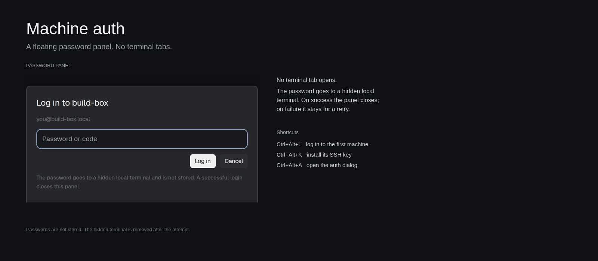

# Machine auth for Herdr

A floating password panel for **Herdr**'s saved SSH machines. When one needs
authentication, click **Login** (or press `Ctrl+Alt+L`), type the password or
code, and the login runs in a hidden local terminal. On success the panel closes;
no terminal tab is left behind.



## Why

Herdr reconnects saved machines in the background, where SSH cannot ask for a
password or a code. After sleep, a network change, or an expired MFA approval,
the machine moves to `needs_login` and Herdr shows the CLI command. This mod puts
a proper password panel in front of that, and offers the permanent key-based fix.

It does not store credentials. The password goes to a hidden local terminal only
for the login attempt; the terminal is removed when it finishes or fails.

## What it does

- Adds a 34px **Machines** strip at the bottom of the layout.
- When everything is connected: `Machines ● N connected`.
- When one needs attention: `Machines ● work needs login` with **Login** and
  **Copy** buttons. A machine that is merely unreachable or asleep gets
  **Retry** instead.
- Click **Login** / **Retry** (or press `Ctrl+Alt+L`) to open the password panel:
  machine, target, one masked input, **Install my SSH key permanently**,
  **Log in**, **Cancel**. On success the panel closes; on failure it stays with
  the SSH error so you can retry.
- The **Install my SSH key permanently** checkbox joins the two flows: the same
  password first installs your public key with `ssh-copy-id`, then logs in with
  it. The choice is remembered for the next login panel.
- **Install key…** in the auth dialog opens the panel with the checkbox
  preselected, so you can jump straight to the permanent flow.
- **Install key…** opens the same panel and runs `ssh-copy-id` for the first of
  `~/.ssh/id_ed25519.pub` or `~/.ssh/id_rsa.pub`, then logs in once. Future
  reconnects use the key and no longer prompt.
- Click **Machines** (or press `Ctrl+Alt+A`) for the auth dialog: every saved
  machine, its target, state, **Login / Retry**, **Install key…**, **Copy**.
- Posts a clickable notification when a machine enters `needs_login`; clicking it
  opens the password panel directly. It repeats after 10 minutes while the
  machine still needs a login.
- Refreshes every 5 seconds; the ↻ button checks immediately.

## Shortcuts

- `Ctrl+Alt+A` — open the auth dialog.
- `Ctrl+Alt+L` — open the password panel for the first machine needing login.
- `Ctrl+Alt+K` — open the install-key panel for the first eligible machine.

Herdr's `Ctrl+Shift+P` palette lists **app commands only**; a mod's own actions
are not added to it. These direct keys are the quick route. The dialog buttons
remain the discoverable route.

## Install

Ask the agent in your Herdr window:

```text
Read ~/.config/herdr-app/AGENTS.md, then add this mod:
https://github.com/ksajan/herdr-machine-auth
```

Or copy it by hand:

```sh
cp -R mods/machine-auth ~/.config/herdr-app/mods/
herdr-app check ~/.config/herdr-app/mods/machine-auth
```

Merge its keys too, or add the lines yourself:

```json
{
  "global": {
    "ctrl-alt-a": "mod.open:machine-auth",
    "ctrl-alt-k": "machine-auth.install-key",
    "ctrl-alt-l": "machine-auth.login"
  }
}
```

The app docks the strip at the bottom of the layout shown at install time. If
you use several layouts, add this block to each one:

```json
{
  "id": "machine-auth",
  "type": "block",
  "size": { "px": 34 },
  "content": { "mod": "machine-auth" }
}
```

Once the gallery has indexed the repo, the short link is
`herdr.dev/mods/ksajan/herdr-machine-auth`.

Requires the Herdr desktop app, `hc` (herdr-core), and `herdr-app` on `PATH`.
Linux and macOS. On Windows, `hc machine login` has no password prompt, so this
mod's login panel is not useful there.

## What it runs and reads

- Runs `hc machine ls --json` locally every 5 seconds.
- Starts the login in a hidden terminal with `hc run --bg`; no pane or tab is
  created.
- Waits for the SSH prompt, sends the password with `hc send --force`, reads the
  result with `hc get`/`hc read`, and removes the hidden terminal.
- The optional **Install key…** action runs `ssh-copy-id`, which reads one public
  key (the first of `~/.ssh/id_ed25519.pub` or `~/.ssh/id_rsa.pub`) and appends it
  to the machine's `authorized_keys`. It reads no private key.
- Posts notifications through Herdr's `notify`.
- Stores no credentials.

## Limits

- The hidden login handles one password/passphrase/code prompt. A machine that
  asks for a second factor after the password may need the command from
  **Copy** in a terminal.
- The strip only runs while its block is in the shown layout. Add the block to
  every layout you use.
- It watches **herdr-core** machines (`hc machine ls`), which is what the app's
  sidebar and spaces use. Machines saved only in the `herdr` TUI are a separate
  catalog; use `herdr machine reconnect` for those.
- **Install key…** only appears for `needs_login` machines with a standard target
  (`via: false`) and uses the first of the two default public keys.
- The password is held in memory until it is sent, then cleared. The hidden
  terminal is removed after the attempt; it is not a pane and leaves no tab.
- `Ctrl+Alt+A`, `Ctrl+Alt+K`, and `Ctrl+Alt+L` can be changed in `keys.json`.
- Herdr's palette can't list mod actions; the direct keys are the shortcut.

## Uninstall

Remove the block from your layouts, or delete the folder:

```sh
rm -rf ~/.config/herdr-app/mods/machine-auth
```

Then switch layouts or restart Herdr. Remove the `ctrl-alt-a`, `ctrl-alt-k`, and
`ctrl-alt-l` lines from `keys.json` too. Saved machines and their SSH auth are
untouched. If you used **Install key…**, the public key stays in the machine's
`~/.ssh/authorized_keys`; remove it there if you want to undo that separately.

## License

MIT. See [LICENSE](LICENSE).
