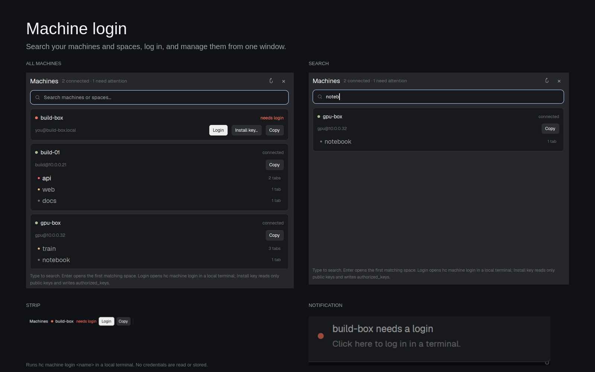

# Machine login for Herdr

A slim strip for the **Herdr desktop app** that watches your saved SSH machines
and offers a **Login** button when one needs authentication. Click it and a
normal local terminal opens inside Herdr running `hc machine login <name>`, so
the password or MFA prompt appears where you are already working. No more
switching to an external terminal and copying the command.



## Why

Herdr reconnects saved machines in the background, where SSH cannot ask for a
password or a code. After sleep, a network change, or an expired MFA approval,
the machine moves to `needs_login` and Herdr shows the CLI command. This mod puts
the missing button next to the message.

It does not store credentials and does not try to answer SSH prompts itself. It
starts the same `hc machine login` command you would run by hand, in a terminal
that can ask.

## What it does

- Adds a 34px **Machines** strip at the bottom of the layout.
- When everything is connected: `Machines ● N connected`.
- When one needs attention: `Machines ● work needs login` with **Login** and
  **Copy** buttons. A machine that is merely unreachable or asleep gets
  **Retry** instead. Several machines scroll horizontally.
- Click **Machines** (or press `Ctrl+Alt+M`) to open the full machine list: every
  saved machine, its target, state, **Login / Retry**, **Install key…**,
  **Copy**, **Go**, and the machine's spaces. Attention comes first. Search
  filters machines and spaces; **Enter** opens the first matching space.
- **Install key…** is the permanent fix: it runs `ssh-copy-id` for your first
  `~/.ssh/id_ed25519.pub` or `~/.ssh/id_rsa.pub`, then logs in once. Future
  reconnects use the key and no longer prompt.
- **Login** / **Retry** opens a local space named `<machine> login` and runs
  `hc machine login <machine>`. The terminal stays open after the command so a
  failed login is readable.
- **Copy** copies `hc machine login <machine>` for use in your own terminal.
- Posts a clickable notification when a machine enters `needs_login`. Clicking
  it does the same as **Login**. It repeats after 10 minutes while the machine
  still needs a login, so a dismissed toast is not the end of the story.
- Refreshes every 5 seconds; the ↻ button checks immediately.

## Install

Ask the agent in your Herdr window:

```text
Read ~/.config/herdr-app/AGENTS.md, then add this mod:
https://github.com/ksajan/herdr-machine-login
```

Or copy it by hand:

```sh
cp -R mods/machine-login ~/.config/herdr-app/mods/
herdr-app check ~/.config/herdr-app/mods/machine-login
```

Once the gallery has indexed the repo, the short link is
`herdr.dev/mods/ksajan/herdr-machine-login`.

The app docks it at the bottom of the layout shown at install time. Merge its
keys too, or add the one line yourself:

```json
{ "global": { "ctrl-alt-m": "mod.open:machine-login" } }
```

If you use several layouts, add this block to each one:

```json
{
  "id": "machine-login",
  "type": "block",
  "size": { "px": 34 },
  "content": { "mod": "machine-login" }
}
```

Requires the Herdr desktop app and `hc` (herdr-core) on `PATH`. Linux and macOS.
On Windows, `hc machine login` has no password prompt, so this mod's Login
button is not useful there.

## Use

- Click **Login**. Type the password or code when the terminal asks.
- After a successful login, Herdr rechecks the machine within about 30 seconds;
  the strip updates by itself.
- If you already have a terminal open, **Copy** gives you the command.
- If the machine is connected but you want to force a fresh check, click ↻.

## What it runs and reads

- Runs `hc machine ls --json` locally every 5 seconds. No network requests from
  the mod.
- Runs `hc machine login <name>` in a normal terminal when you click Login.
- The optional **Install key…** action runs `ssh-copy-id`, which reads one
  public key (the first of `~/.ssh/id_ed25519.pub` or `~/.ssh/id_rsa.pub`) and
  appends it to the machine's `authorized_keys`. It reads no private key and
  does not handle the password; SSH asks in the terminal.
- Posts notifications through Herdr's `notify`.
- Stores no credentials.

## Limits

- The strip only runs while its block is in the shown layout. Add the block to
  every layout you use.
- It watches **herdr-core** machines (`hc machine ls`), which is what the app's
  sidebar and spaces use. Machines saved only in the `herdr` TUI are a separate
  catalog; use `herdr machine reconnect` for those.
- The notification action uses `space.new`, so it works with Herdr's shipped
  toast and with custom toasts that run notification actions.
- A machine that is merely unreachable gets **Retry**. It will try
  authentication and then show the actual SSH error in the terminal.
- **Install key…** only appears for `needs_login` machines with a standard
  target (`via: false`) and only uses the first of the two default public keys.
  For a custom port, a Host alias that `ssh-copy-id` cannot parse, or a
  different key, run `ssh-copy-id` once in your own terminal.
- The dialog's **Go** button selects the first space on that machine. It is
  hidden if that machine has no space on the current screen. Its **spaces** rows
  do the same for one space; the search field matches machine names, targets,
  states and space names.
- The mod quotes machine names for the `sh -c` wrapper; names from `hc` are
  already constrained, but the quoting keeps a renamed machine safe.
- `Ctrl+Alt+M` is the default list shortcut. Change or remove it in
  `keys.json` if it conflicts with something you use.

## Uninstall

Remove the block from your layouts, or delete the folder:

```sh
rm -rf ~/.config/herdr-app/mods/machine-login
```

Then switch layouts or restart Herdr. Remove the `ctrl-alt-m` line from
`keys.json` too. The saved machines and their SSH auth are untouched. If you
used **Install key…**, the public key stays in the machine's
`~/.ssh/authorized_keys`; remove it there if you want to undo that separately.

## License

MIT. See [LICENSE](LICENSE).
