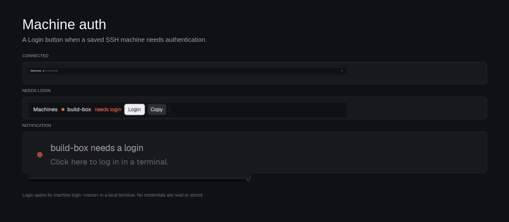

# Machine login

A slim bottom strip for the Herdr desktop app that watches saved SSH machines.
When one needs authentication it shows a **Login** button; clicking it opens a
normal local terminal inside Herdr and runs `hc machine login <machine>`, so the
password or code prompt appears where the person already is. It also posts a
clickable notification for the same action. It stores no credentials and never
tries to answer SSH itself.



## What you see

A 34px strip across the bottom of the window, on Herdr's `chrome` background.
From left to right:

- **Machines**, 12px medium in `foreground`.
- While the first read runs: `checking…`, 11px `dim`.
- When every machine is connected: a 6px `ansi2` dot and `N connected`, 11px
  `dim`. With no machines: a `dim` dot and `none added`.
- When one or more need attention: rows laid out left to right, scrolling
  horizontally when they do not fit. Each row has a 6px dot (`blocked` for
  `needs_login`, `dim` otherwise), the machine name in `foreground` (up to
  140px, truncated), the state in 11px (`blocked` for `needs_login`, otherwise
  `dim`), a **Login** button, a **Copy** button and a 1×16px `border` divider.
  - Login / Retry: 24px high, 8px horizontal padding, radius 5, `solid`
    background, `solid_foreground` text, 11px medium. It reads `Login` for
    `needs_login` and `Retry` for every other non-connected state. Hover dims it
    to 0.88; its tooltip names the target, state, `why` when `hc` gives one, and
    the exact command.
  - Copy: same size, radius 5, `raised` background, `foreground` text. After a
    copy it reads `Copied` until another copy.
- A refresh button at the far right: 24×24px, radius 5, `↻`, `hover`
  background and `foreground` text on hover.
- If the check fails, the middle is one truncated line in `blocked`:
  `Couldn't check machines: <error>`; its tooltip has the full error.

The preview uses a synthetic `build-box` machine to show the needs-login row;
the running mod reads the real `hc machine ls`.

## How it behaves

- Every 5 seconds it runs `hc machine ls --json`. The first read starts at
  init. The refresh button starts another read immediately.
- Temporary machines (`temporary: true`) are left out.
- Every machine whose state is not `connected` gets a row. That includes
  `needs_login`, `unreachable`, `asleep` and unknown states. The button reads
  **Login** for `needs_login` and **Retry** otherwise; both run the same
  `hc machine login`, and the login terminal shows the real SSH error if the
  problem was not authentication.
- When a machine enters `needs_login`, it posts one notification:
  title `<name> needs a login`, body `Click here to log in in a terminal.`,
  level `error`, action `space.new` with the login arguments below. The action
  is an ordinary app command, so Herdr's shipped toast and any custom toast that
  runs actions can use it. While the machine stays in `needs_login`, the notice
  repeats after 10 minutes; when it leaves that state the record is cleared.
- **Login / Retry** calls `run("space.new", ...)` to make a **local** space
  (machine `""`) named `<machine> login`, with a tab named `login`. Its command
  is:

  ```sh
  hc machine login <machine>; code=$?; printf '\nLogin exited %s. Press Enter to close.\n' "$code"; read _
  ```

  Running it in `sh -c` keeps the terminal open after the command, so an error
  or a refused password is readable. The space is local even when the selected
  space is on another machine, so the login terminal is always available.
- **Copy** writes `hc machine login <machine>` to the clipboard. It is the same
  command the shipped Spaces mod offers; this mod adds the button.
- The strip does not switch to the machine, open settings or change the layout.
- No credentials are read, written or cached. The terminal asks; SSH owns the
  prompt.

## Built from

- One mod, `mods/machine-login/`:
  - `mod.json`: `{ "place": "bottom", "size": 34, "title": "Machine login" }`.
    The first time Herdr sees the folder it docks the strip into the shown
    layout. There is no `overlay` and no `keys.json`; the strip is the whole
    surface.
  - `main.js`: imports `View`, `div` from `gpui-kit`, `v_flex`, `h_flex` from
    `gpui-base`, and `hc`, `notify`, `run`, `theme` from `herdr`.
    - `shellArg(value)` leaves plain machine names alone and single-quotes
      anything else, escaping embedded single quotes.
    - `commandFor(machine)` returns `hc machine login <quoted>`.
    - `loginArgs(machine)` returns the `space.new` arguments above.
    - `init` sets empty/loading state, a 5-second `cx.timer.every`, and starts
      the first read.
    - `refresh` uses `cx.spawn(async (cx) => ...)`, checks `r.code`, parses
      `r.stdout` as JSON, filters temporary machines, calls `notifyLogins`, and
      sets `loading`/`error` before `cx.notify()`.
    - `notifyLogins` keeps `this.notified` as a per-machine timestamp and posts
      at most one notice per 10 minutes for a machine in `needs_login`.
    - `row` draws the dot, name, state, Login, Copy and divider.
    - `render` chooses checking / error / all-connected / attention, and always
      draws the refresh button.
- No images, fonts, SVGs or other assets. No file reads, no `exec`, no network
  requests. `hc` is the only program the strip runs, and only to list machines.
  The login command runs only after a click, in a normal terminal.

## Watch out

- **`hc` must be on `PATH`** in the app's environment. Herdr installs it; a
  custom setup that only has `herdr-core` needs a symlink or a different command.
  If `hc` fails, the strip shows `Couldn't check machines: ...`.
- **This watches herdr-core's machine catalog**, the one the app's spaces and
  sidebar use (`hc machine ls`). Machines saved only in the `herdr` TUI are a
  separate catalog; use `herdr machine reconnect` for those. Do not assume
  `herdr machine list` sees the same machines.
- **The login wrapper assumes a POSIX shell.** `sh -c` and `read _` work on
  Linux and macOS. On Windows `hc machine login` has no password prompt, so the
  button is not useful there. Do not replace `sh` with the user's interactive
  shell: fish and nushell parse the wrapper differently.
- **The space is deliberately local.** Passing the machine being viewed would
  put the login terminal on the broken machine. `machine: ""` is this computer.
  A local space is created even if the current space is remote.
- **The notification action is `space.new`**, not a mod command. Mod commands
  receive no args through `notify`; using `space.new` keeps the action working
  with the shipped toast and with custom toasts that call `run(action.name,
  action.args)`.
- **Only one copy per layout.** The strip polls while its block is shown, like
  any mod. If the person uses several layouts, add the block to each one; a
  layout without it has no strip and no notifications.
- **Do not filter out unknown states.** A machine can be `unreachable` or
  `asleep` and still need a login attempt; showing Login for every non-connected
  state is the safe behavior. The login terminal reports the real failure.
- **Do not auto-run the login.** Starting SSH without a click would put a
  credential prompt on screen at arbitrary times. The mod only opens the
  terminal after a click, refresh, or notification action.
- **The 10-minute repeat is intentional.** A dismissed notification should not
  hide a machine that still needs a person forever; a successful login clears
  the state and the timer.
- **The refresh button does not clear `notified`.** If a machine is still in
  `needs_login`, a manual refresh must not spam a new toast; the timestamps are
  the throttle.
- **Machine names may contain punctuation.** Always pass them through
  `shellArg` for the wrapper. Never interpolate an unquoted name into a shell
  line.

## Done when

- `herdr-app check ~/.config/herdr-app/mods/machine-login` passes.
- With all machines connected, the strip reads `Machines ● N connected` and the
  ↻ button triggers a fresh read without changing the layout.
- Temporarily forcing one machine to `{ state: "needs_login", target:
  "you@build-box.local" }` shows `Machines ● build-box needs login` with
  **Login** and **Copy**, and posts one notification whose click would run the
  same login.
- Clicking **Login** creates a local space named `build-box login` with a
  `login` tab, and the terminal shows the `(user@host) Password:` prompt (or the
  real SSH error). Closing the space leaves the saved machine untouched.
- **Copy** puts `hc machine login build-box` on the clipboard and briefly reads
  `Copied`.
- A successful `hc machine login work` changes the strip back to `connected`
  within one poll or one manual refresh.
- Removing the block from the layout removes the strip; deleting the mod folder
  leaves layouts, keys, machines and SSH auth untouched.
