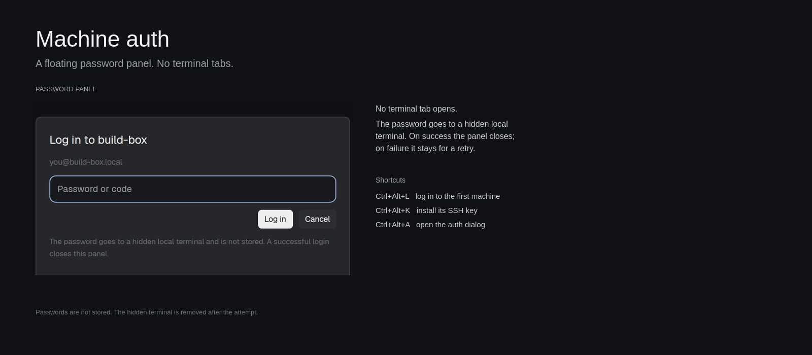

# Machine auth

A floating password panel for the Herdr desktop app's saved SSH machines. When a
machine needs authentication, the strip's **Login** / **Retry** button — or
`Ctrl+Alt+L` — opens a dialog with one masked input. The login runs in a hidden
local terminal, so no pane or tab appears; on success the panel closes, on failure
it stays with the SSH error. It also offers a permanent **Install key** flow and
a clickable `needs_login` notification.

## What you see

A 34px strip across the bottom of the window, on `chrome`:

- **Machines**, 12px medium in `foreground`; clicking it opens the auth dialog.
- `checking…` while the first read runs.
- `N connected` with a 6px `ansi2` dot when all are connected; `none added` when
  there are no machines.
- Attention rows, scrolling horizontally: 6px dot (`blocked` for
  `needs_login`), machine name (up to 140px), state (11px), **Login** / **Retry**,
  **Copy**, 1×16px divider. The Login/Retry tooltip names the target, state,
  `why`, and the command.
- A 24×24px refresh `↻` at the right.
- Errors replace the middle with one truncated `blocked` line; its tooltip has
  the full message.

`Machines` / `Ctrl+Alt+A` opens a 640×460 dialog on `popover`:

- Header **Machine auth** 17px semibold, connected/attention counts, refresh, ×.
- Attention-first cards on `surface`, rounded 8, with a border: state dot, name
  13px medium, state, **Login / Retry**, **Install key…** (needs_login, target,
  `via: false`), **Copy**, and a target line with `why`.
- Footer: shortcut hints and "Passwords go to a hidden local terminal; nothing
  is stored."

**Login / Retry / Install key** opens a 440×280 password panel on `popover`:

- Title `Log in to <machine>` or `Install key on <machine>`.
- Target line, 11px `dim`.
- A 38px masked input with `accent` border, `Password or code` placeholder,
  auto-focused.
- **Log in** / **Install key and log in** primary button and **Cancel**.
- Status: `Waiting for the password prompt…`, the SSH error in `blocked`, or the
  success line in `done`.
- A note: "The password goes to a hidden local terminal and is not stored. A
  successful login closes this panel."

A notification says `<machine> needs a login`, body "Click here to open the
password panel.", level `error`. Clicking it opens the panel for that machine.

## How it behaves

- `refresh` runs `hc machine ls --json` every 5s and filters temporary machines.
  The strip copy notifies; the dialog copy does not.
- On `needs_login`, `notifyLogins` stores the machine in
  `setShared("machine-auth.pending", name)` and posts a notification whose action
  is the mod command `machine-auth.prompt`. The nextCommand loop reads the shared
  name and opens the password panel.
- The panel's `submit` trims nothing (passwords may contain spaces): a non-empty
  value is stored in `pendingPassword`, the input is cleared immediately, and
  `startHidden` runs.
- `startHidden` starts a hidden PTY terminal:
  - login: `hc run --bg --json --name auth-<base36-time> -- hc machine login <machine>`
  - key: `hc run --bg --json --name ... -- sh -c <keyLine>`, where `keyLine` picks
    the first default public key, runs `ssh-copy-id`, then `hc machine login`.
  The returned address is kept; the terminal is not attached to a pane.
- `pollPrompt` checks `hc get` for a finished terminal, then `hc read` for a
  prompt (`password`, `passphrase`, `passcode`, `verification`, `authenticator`).
  When it appears it sends `pendingPassword` with `hc send --force`, clears the
  field, and starts `watch`.
- `watch` checks `hc get` for finish and `hc read` for
  `permission denied` / `authentication failed` / `incorrect` / `try again` or a
  second `passcode`/`verification` prompt. It times out after about 30s.
- `finish` reads the output, removes the hidden terminal with `hc rm`, then:
  success → `done`, close the panel after 700ms; failure → `error` with the last
  three non-empty output lines and keep the panel for a retry.
- `fail` kills and removes the hidden terminal, sets the error, and keeps the
  panel. `cancel` / Esc does the same and closes.
- **Copy** writes `hc machine login <machine>`; it is the fallback for multi-step
  MFA.
- `Ctrl+Alt+L` opens the panel for the first `needs_login` machine.
  `Ctrl+Alt+K` does so in install-key mode for the first eligible machine.
  With nothing to do, each posts an info notification.

## Built from

- One mod, `mods/machine-auth/`:
  - `mod.json`: `{ "place": "bottom", "size": 34, "title": "Machine auth",
    "version": "0.8.0", "overlay": { "kind": "dialog", "width": 640,
    "height": 460 } }`. The strip docks on first sight; the overlay is the auth
    dialog. The password panel is opened with `openOverlay` and its own
    440×280 props.
  - `keys.json`: `ctrl-alt-a` opens the dialog, `ctrl-alt-l` opens the first
    login panel, `ctrl-alt-k` opens the first install-key panel.
  - `main.js`: imports `View`, `div` from `gpui-kit`, `v_flex`, `h_flex`,
    `InputState`, `Input` from `gpui-base`, and `hc`, `notify`, `theme`, `props`,
    `openOverlay`, `closeOverlay`, `nextCommand`, `setShared`, `shared` from
    `herdr`.
    - `shellArg` / `commandFor` quote the machine for Copy and tooltips.
    - `keyLine(machine, target)` is the hidden `ssh-copy-id` + login shell.
    - `init` reads `props().prompt` / `target` / `action`; the prompt copy creates
      the masked `InputState` and focuses it. The strip/list copy starts the
      `nextCommand()` loop and the 5s refresh.
    - `refresh`, `notifyLogins`, `openList`, `openPrompt`, `installKeyShortcut`,
      `loginShortcut`, `close` manage the machine state and entries.
    - `button`, `renderStrip`, `stripRow`, `authCard`, `renderList` draw the
      strip and auth dialog.
    - `submit`, `startHidden`, `pollPrompt`, `watch`, `finish`, `fail`, `cancel`
      implement the hidden login and panel lifecycle.
    - `renderPrompt` draws the 440×280 panel; `render` chooses prompt / dialog /
      strip.
- No images, fonts or other assets. No network requests.
  `hc run` starts the hidden PTY; `hc send` supplies the password; `hc get` /
  `hc read` detect the prompt and result; `hc rm` removes the hidden terminal.

## Watch out

- **`hc` and `herdr-app` must be on `PATH`.** `hc run` needs the core; removing
  the hidden terminal uses `hc rm`.
- **This is not a terminal fallback.** A machine that asks for a second factor
  after the password will fail with the one-time-code message. Use **Copy** and
  run `hc machine login <machine>` in a terminal for multi-step MFA.
- **The hidden terminal still exists briefly.** It has a PTY, but no pane/tab.
  Remove it on success, failure, timeout, and cancel. Do not leave `auth-*`
  terminals in `hc ls`.
- **The password is sensitive.** Keep it only in `pendingPassword` until `hc
  send`; clear the input immediately; never write it to disk, a log, a label, or
  a notification. The hidden terminal's scrollback is removed with it.
- **Prompt detection is heuristic.** Match password/passphrase/passcode/
  verification/authenticator; if none appears within about 12s, fail instead of
  hanging. `ssh` disables echo for the password, but do not assume every program
  will.
- **Start the terminal without `--rm`** so `hc get`/`hc read` can inspect it;
  remove it explicitly with `hc rm` after reading.
- **`hc run` names are unique and short.** `auth-<base36-time>` is under 32
  chars and uses only lowercase/digits.
- **Use `hc send --force`.** The hidden terminal may be seen as blocked while
  waiting for a password; `--force` is what lets the panel answer it.
- **Do not put the password on a command line.** It goes through `hc send` to
  the PTY, never through a shell argument or a file.
- **The palette does not list mod actions.** `Ctrl+Shift+P` is app commands only;
  the direct keys and dialog buttons are the route.
- **`Ctrl+Alt+A/K/L` may be taken.** They are in `keys.json`; the person can
  change or drop them. The Machines label still opens the dialog.

## Done when

- `herdr-app check ~/.config/herdr-app/mods/machine-auth` passes.
- With all machines connected, the strip reads `Machines ● N connected`; ↻
  refreshes without changing the layout.
- Temporarily forcing `work` to `needs_login` and pressing `Ctrl+Alt+L` opens the
  440×280 password panel. A successful submit (key auth) closes the panel, leaves
  no `auth-*` terminal, and switches the strip back to connected.
- A wrong password keeps the panel open with a readable SSH error and removes the
  hidden terminal.
- **Install key…** runs `ssh-copy-id`, logs in once, closes the panel on success,
  and leaves no visible tab.
- **Copy** puts `hc machine login <machine>` on the clipboard.
- The notification's action opens the password panel for that machine.
- Removing the block and mod folder leaves layouts, machines and SSH auth
  untouched.
